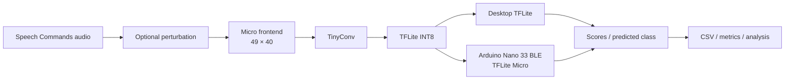

# FIATSAR — TinyML Robustness on Arduino Nano 33 BLE Sense

Robustness evaluation of a **TinyML Keyword Spotting (KWS)** system, from Google Speech Commands to deployment on an **Arduino Nano 33 BLE Sense** using TensorFlow Lite Micro.

The project studies how an embedded speech-command model behaves under input perturbations, how robustness can be improved through retraining, and whether the behavior measured on desktop TensorFlow Lite is preserved after INT8 quantization and microcontroller deployment.

> **Academic work in progress.**  
> This repository is a curated public snapshot of the FIATSAR project and does not contain the complete internal workspace.

---

## Project objective

The project addresses the following question:

> **Can an embedded keyword-spotting model remain reliable when its input is perturbed?**

The motivating use case is an embedded voice-command system where some classification errors may be more critical than others.

Examples include:

- `stop → go`
- `left → right`
- `on → off`
- command → `_silence_`

The experimental platform is designed to compare the behavior of the same TinyML model across:

```text
clean input
    ↓
perturbed input
    ↓
TensorFlow / Keras
    ↓
TFLite INT8 on desktop
    ↓
TFLite Micro on Arduino
```


---

## From a 2-class prototype to a 12-class benchmark

The project started with a simple **2-class prototype** used to validate the inference chain.

It was then scaled to the official **Google Speech Commands v0.02** dataset.

### Dataset

- **105,829** one-second audio clips
- **35** original words
- **2,618** speakers
- **16 kHz** sampling rate

The final TinyConv benchmark contains **12 classes**:

```text
_silence_
_unknown_
yes
no
up
down
left
right
on
off
stop
go
```

The reproducible split used in the project is:

| Split | Samples |
|---|---:|
| Train | 35,693 |
| Validation | 4,297 |
| Test | 4,726 |

Each audio clip is transformed by the TensorFlow micro frontend into a:

```text
49 × 40 = 1,960 features
```

input representation.


---

## Experimental pipeline

The project keeps the preprocessing and evaluation chain as consistent as possible between PC and embedded execution.



Main tools:

- **TensorFlow 2.20 / Keras**
- TensorFlow Lite INT8
- TensorFlow Lite Micro
- Python
- NumPy
- pandas
- SciPy
- Matplotlib
- PySerial
- Arduino IDE


---

## Evaluation methodology

Two complementary scenarios are used.

### Scenario B — evaluate an existing model

The model remains unchanged and only the evaluation data is perturbed.

```text
reference model
      ↓
perturbed test set
      ↓
robustness evaluation
```

This answers:

> How robust is an already deployed model?

For white-noise experiments, the reference campaign was repeated with **5 independent noise seeds**.

Metrics include:

- accuracy;
- attack / prediction-switch rate;
- class recall;
- normalized confusion matrices;
- mean and standard deviation;
- 95% confidence intervals;
- McNemar comparisons.

### Scenario A — robust retraining

Perturbations are introduced during training.

```text
clean + perturbed training data
          ↓
      Keras training
          ↓
  robust model evaluation
```

This answers:

> Can robustness be improved without sacrificing clean performance?

---

## Noise robustness study

### White Gaussian noise

White Gaussian noise provides a synthetic, reproducible perturbation whose severity can be controlled using SNR.

The tested range is:

```text
30 dB → 20 dB → 15 dB → 10 dB → 5 dB → 0 dB
```

**10 dB** is used as the nominal noisy condition.

The 5–15 dB region is treated as the main plausible noisy region, while 0 dB represents a severe worst-case condition.


---

## Reference INT8 model

The reference TinyConv model reaches:

```text
73.9% clean accuracy
```

under the original TensorFlow training recipe.

Mean results over five Gaussian-noise seeds:

| SNR | Accuracy | Δ vs clean | ASR |
|---|---:|---:|---:|
| 30 dB | 75.1 ± 0.1% | +1.2 pt | 5.9% |
| 20 dB | 73.6 ± 0.1% | -0.3 pt | 10.2% |
| 15 dB | 71.8 ± 0.4% | -2.1 pt | 13.6% |
| **10 dB** | **68.1 ± 0.4%** | **-5.8 pt** | **18.6%** |
| 5 dB | 62.3 ± 0.4% | -11.6 pt | 26.1% |
| 0 dB | 52.9 ± 0.6% | -21.1 pt | 38.0% |

The standard deviation remains below approximately **0.6 percentage point**, indicating that the degradation observed from 15 dB downward is much larger than seed-to-seed variation.


---

## Confusion matrices

Global accuracy alone does not describe the complete effect of noise.

Some classes degrade much faster than others.

At **10 dB**:

```text
stop : 85% → 57%
left : 76% → 64%
no   : 66% → 56%
```

At **0 dB**:

```text
stop  : 85% → 29%
right : 84% → 50%
left  : 76% → 50%
no    : 66% → 39%
```

Typical increased confusions include:

```text
left → yes
stop → up
stop → off
go → unknown
```

The effect is therefore not only a global accuracy decrease: noise changes **which semantic commands are confused**.

<p align="center">
  
  
</p>

---

## Why retrain the model?

To evaluate robust training fairly, a Keras baseline was created with:

- the same TinyConv architecture;
- the same 49 × 40 input;
- the same 12 outputs;
- the same Speech Commands split;
- **25 epochs**;
- Adam optimizer;
- no noise augmentation.

Its clean accuracy is:

```text
75.0%
```

which is comparable to the original TensorFlow reference at **73.9%**.

This Keras model is therefore used as the control when evaluating retrained models.


---

## Fixed-SNR training

Training only at one SNR improves robustness around that specific condition, but creates a strong distribution shift.

Example: model trained at **10 dB**.

```text
clean test : 36.2%
10 dB test : 72.0%
0 dB test  : 55.8%
```

The model becomes good around its training condition but almost unusable on clean speech.


---

## Mixed-noise training

The best current compromise is a mixed training strategy.

Each clean training clip is combined with one Gaussian-noise copy whose SNR is randomly sampled between:

```text
0 and 20 dB
```

The resulting model achieves:

| Test condition | Accuracy |
|---|---:|
| Clean | **75.9%** |
| 20 dB | **74.3%** |
| 15 dB | **73.2%** |
| 10 dB | **71.6%** |
| 5 dB | **66.6%** |
| 0 dB | **59.5%** |

At the nominal **10 dB** condition:

```text
Keras clean-trained : 55.0%
Mixed 0–20 dB      : 71.6%
```

while clean accuracy remains essentially unchanged.

This makes mixed training the best robustness / clean-performance compromise evaluated so far.


---

## Training-condition × test-condition comparison

Fixed-SNR models are generally strongest near their own training condition.

The mixed model is more balanced across the complete test range.


This highlights an important design tradeoff:

> optimizing for a single operating point can increase local robustness while reducing generalization.

---

## Which words are most affected?

Noise does not affect all commands uniformly.


At the nominal 10 dB condition, the first classes to degrade are mainly:

- `stop`
- `left`
- `no`

At severe noise levels, some errors correspond to confusion between acoustically similar commands, while others correspond to the model no longer recognizing the command at all.

---

## Where do errors go?

At severe noise levels, the distribution of errors depends strongly on the training strategy.

The clean-trained Keras model can develop an **absorbing class**.

For example, at 0 dB:

```text
62% of its errors are predicted as _silence_
```

The mixed model distributes its errors more evenly:

```text
no predicted class receives more than ≈14% of errors
```


---

## Adversarial robustness — current V1

A second branch of the project studies gradient-based adversarial perturbations.

Current work includes:

- FGSM;
- PGD;
- perturbations generated in the model feature space;
- evaluation of controlled perturbation budgets;
- preparation for adversarial training.

The TinyConv input is the `49 × 40` feature representation rather than the raw waveform.

A current research question is therefore:

> Can a feature-space adversarial perturbation be related back to a physically meaningful audio perturbation?

This part is still under active development and is intentionally not detailed extensively in this public snapshot.

---

# Embedded deployment

## From TFLite to Arduino firmware

The selected models are quantized to INT8 and converted into C/C++ arrays for integration into the Arduino firmware.

```text
Keras model
    ↓
TFLite INT8
    ↓
Arduino-compatible TFLite model
    ↓
C/C++ byte array
    ↓
model_data.cpp / model_data.h
    ↓
Arduino sketch
    ↓
TensorFlow Lite Micro
```

Example:

```cpp
alignas(16) const unsigned char g_model[] = {
    0x20, 0x00, 0x00, ...
};

const int g_model_len = 51224;
```


---

## Deterministic PC ↔ Nano testing

For controlled campaigns, the Arduino microphone is disabled.

The PC sends the exact already-quantized feature tensor used by the desktop interpreter:

```text
1 clip
   ↓
1,960 INT8 features
   ↓
USB serial
   ↓
Arduino / TFLite Micro
   ↓
Invoke()
   ↓
12 INT8 output scores
   ↓
PC comparison
```

The serial link runs at:

```text
115200 baud
```

with feature data transferred in **64-byte packets**.

The Arduino acknowledges each packet before the next one is transmitted, preventing USB buffer loss during long campaigns.


---

## Quantization validation

INT8 quantization has a negligible effect on accuracy.

| Test set | Float32 | INT8 |
|---|---:|---:|
| Clean | 74.0% | 73.9% |
| 30 dB | 75.0% | 74.9% |
| 20 dB | 73.6% | 73.6% |
| 15 dB | 71.8% | 71.8% |
| 10 dB | 68.0% | 68.0% |
| 5 dB | 62.2% | 62.1% |
| 0 dB | 53.6% | 53.4% |

Maximum measured accuracy difference:

```text
≤ 0.23 percentage point
```

The INT8 representation also reduces the model size from approximately:

```text
196 KB → 51 KB
```

or about:

```text
×3.8 smaller
```


---

## PC ↔ Arduino agreement

For the reference model, full 4,726-sample campaigns show near-perfect reproduction of desktop inference on the Nano.

| Test set | Arduino accuracy | PC INT8 accuracy | Agreement |
|---|---:|---:|---:|
| Clean | 73.9% | 73.9% | 99.98% |
| 30 dB | 74.9% | 74.9% | 100.00% |
| 20 dB | 73.7% | 73.7% | 100.00% |
| 10 dB | 68.0% | 68.0% | 100.00% |
| 5 dB | 62.2% | 62.2% | 100.00% |
| 0 dB | 53.5% | 53.5% | 100.00% |

Mean inference latency:

```text
≈ 83.7 ms
```

This demonstrates that the robustness measured with the desktop INT8 interpreter is reproduced by the embedded TFLite Micro implementation.


---

## TFLite Micro compatibility issue

During the embedded integration, an important numerical compatibility issue was identified.

### Symptom

On an initial 50-clip validation set:

```text
PC / Arduino agreement ≈ 80%
```

despite the model apparently running correctly.

### Cause

TensorFlow 2.20 quantized the final fully-connected layer **per channel**, producing 12 separate weight scales.

The older Arduino TensorFlow Lite Micro implementation used in the project interpreted only one scale for the layer.

The issue therefore affected mainly ambiguous clips while leaving many obvious predictions unchanged.

### Fix

The final dense layer was converted to **per-tensor quantization**.

After correction:

```text
prediction agreement
80% → 100%

score-level agreement
0% → 100%
```

The accuracy cost is only about:

```text
-0.04 percentage point
```

Additional embedded fixes included:

- adding the required `CONV_2D` operator;
- increasing the Tensor Arena;
- transmitting all 12 class scores;
- introducing serial packet acknowledgements.


---

## Mixed model — recent embedded validation

A more recent campaign evaluates the **mixed 0–20 dB robust model** on the Nano.

On a fixed nominal set of 500 samples:

| Metric | Result |
|---|---:|
| PC INT8 accuracy | **75.20%** |
| Nano accuracy | **75.20%** |
| PC / Nano agreement | **100%** |
| Mean latency | **83.191 ms** |
| Model size | **51,224 bytes** |

Full noisy campaigns currently validated:

| Condition | PC INT8 | Nano | Agreement |
|---|---:|---:|---:|
| 30 dB | 75.16% | 75.20% | 99.96% |
| 20 dB | 74.31% | 74.27% | 99.96% |

The 10 / 5 / 0 dB embedded campaigns are being replayed after a serial framing desynchronization observed during the long 10 dB campaign.

The affected Nano values are therefore intentionally not reported as model performance.

---

## My contribution

FIATSAR is a two-student ENSIM engineering project.

My main contribution focuses on the **embedded and experimental-validation side**:

- TensorFlow Lite Micro deployment;
- Arduino Nano 33 BLE Sense integration;
- INT8 model compatibility;
- model conversion and firmware integration;
- PC ↔ Nano serial protocol;
- deterministic embedded campaigns;
- latency and memory measurements;
- PC / Nano numerical consistency;
- diagnosis and correction of TFLM compatibility issues;
- validation of robust models on the target;
- embedded experimental tooling.

The dataset generation, noise experiments, model retraining, robustness analysis and adversarial experiments are developed jointly within the project.

---

## Repository structure

```text
FIATSAR-TinyML-Robustness/
├── docs/
│   ├── ARCHITECTURE.md
│   ├── RESULTS.md
│   ├── REPRODUCTION.md
│   └── figures/
├── firmware/
├── models/
├── results/
│   ├── noise/
│   ├── adversarial/
│   └── embedded/
├── scripts/
│   ├── data/
│   ├── adversarial/
│   ├── tools/
│   └── analysis/
├── requirements.txt
└── NOTICE.md
```

The complete internal project contains additional experimental branches that are not all documented in this public snapshot.

---

## Quick start

### Python environment

```bash
python -m venv .venv
```

Windows:

```bash
.venv\Scripts\activate
```

Install dependencies:

```bash
pip install -r requirements.txt
```

---

## Reproducibility

The full Google Speech Commands dataset is not bundled in this repository.

To reproduce the experiments:

1. obtain **Speech Commands v0.02**;
2. reproduce the official TensorFlow speaker-hash split;
3. generate the `49 × 40` micro frontend features;
4. quantize inputs using the TFLite tensor scale and zero-point;
5. use the same evaluation sets;
6. use the experiment-specific scripts documented in:

```text
docs/REPRODUCTION.md
```

Exact Python dependencies are available in:

```text
requirements.txt
```

---

## Current limitations

- adversarial attacks are currently an active V1 research branch;
- feature-space perturbations are not yet equivalent to physically validated over-the-air audio perturbations;
- embedded mixed-model campaigns at 10 / 5 / 0 dB are being replayed after a UART framing issue;
- the complete Speech Commands dataset is not included;
- this repository is a curated snapshot rather than the complete internal workspace.

---

## Academic context

FIATSAR is a **5th-year ENSIM engineering project** focused on the robustness and embedded deployment of TinyML neural networks.

This repository documents:

- reproducible KWS evaluation;
- noise robustness;
- robust retraining;
- INT8 quantization;
- TensorFlow Lite Micro deployment;
- PC ↔ microcontroller validation;
- ongoing adversarial-robustness work.

No open-source license is currently granted.

See [`NOTICE.md`](NOTICE.md) for usage information.
