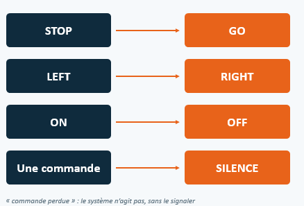
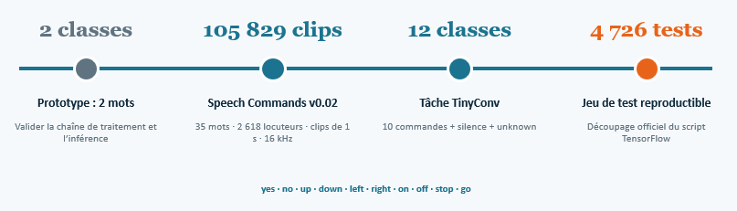
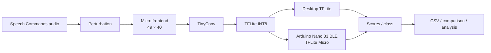
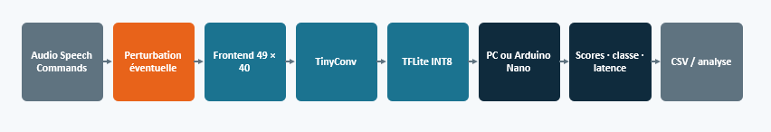
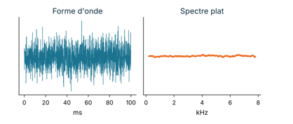
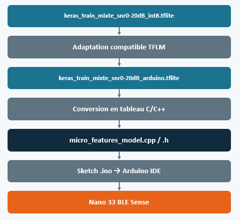
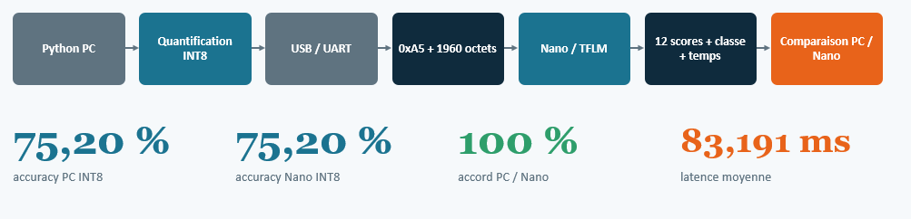

# FIATSAR — TinyML Robustness on Arduino Nano 33 BLE

Robustness evaluation of a **TinyML Keyword Spotting (KWS)** system, from Google Speech Commands to deployment on an **Arduino Nano 33 BLE Sense** with TensorFlow Lite Micro.

The project studies how a quantized speech-command model behaves when its input is perturbed, and whether the robustness measured on a desktop TFLite interpreter is preserved after deployment on a microcontroller.

> **Academic work in progress.**  
> This repository is a curated public snapshot of the FIATSAR project and does not contain the complete internal workspace.

---

## Project objective

The project addresses a simple question:

> **Can an embedded keyword-spotting model remain reliable when its input is perturbed?**

The motivating use case is an embedded voice-command system in a vehicle, where not all classification errors have the same impact.

Examples of critical confusions include:

- `stop → go`
- `left → right`
- `on → off`
- command → `_silence_`

The experimental platform is therefore designed to compare:

```text
nominal behavior
        ↓
perturbed behavior
        ↓
desktop TFLite
        ↔
Arduino / TFLite Micro
```



---

## From a 2-class prototype to a 12-class benchmark

The first prototype used only **2 classes** to validate the complete inference chain.

The project was then scaled to the official **Google Speech Commands v0.02** dataset.

### Dataset

- **105,829** one-second audio clips
- **35** original words
- **2,618** speakers
- **16 kHz** sampling rate

The final TinyConv task contains **12 classes**:

```text
_silence_
_unknown_
yes
no
up
down
left
right
on
off
stop
go
```

The reproducible split used by the project is:

| Split | Samples |
|---|---:|
| Train | 35,693 |
| Validation | 4,297 |
| Test | 4,726 |

Each audio clip is transformed by the TensorFlow micro frontend into a:

```text
49 × 40 = 1,960 feature
```

input tensor.



---

## Experimental pipeline

The same quantized input is used whenever possible on both the desktop and embedded targets.



Main tools:

- Python
- TensorFlow / Keras
- TensorFlow Lite INT8
- TensorFlow Lite Micro
- NumPy
- Pandas
- Matplotlib
- PySerial
- Arduino IDE



---

## Current robustness study

The current public snapshot focuses mainly on the **input-perturbation / adversarial branch** of the project.

Two complementary perturbation families are considered:

### Additive noise

Two noise types are used:

#### White Gaussian noise

- synthetic;
- reproducible;
- controlled through a target SNR;
- useful for measuring the influence of noise level independently.

#### Real background noise

Examples are taken from the Speech Commands `_background_noise_` folder:

- `doing_the_dishes.wav`
- `running_tap.wav`
- `exercise_bike.wav`

These signals are used to test generalization to more realistic acoustic conditions.



---

## Why 10 dB?

Several SNR values are evaluated:

```text
30 dB → 20 dB → 15 dB → 10 dB → 5 dB → 0 dB
```

The project uses **10 dB as the nominal noise condition**.

It provides a useful compromise:

- sufficiently noisy to expose model weaknesses;
- still representative of plausible noisy acoustic environments;
- less extreme than the 0 dB worst-case condition.

The SNR is measured on the complete clip, including silent sections.

---

## Evaluation methodology

Two experimental scenarios are used.

### Scenario B — robustness of an already deployed model

The model is unchanged.

```text
clean-trained model
        ↓
noisy / perturbed test set
        ↓
evaluation
```

This measures the robustness of an existing model without retraining.

### Scenario A — robust retraining

Perturbations are introduced during training.

```text
perturbed training data
        ↓
Keras retraining
        ↓
perturbed evaluation
```

The objective is to improve robustness while preserving clean-data performance.

Main metrics include:

- accuracy;
- attack success / prediction-flip rate;
- class recall;
- confusion matrices;
- SNR;
- desktop ↔ embedded agreement.

---

## Noise robustness — selected results

### Reference TensorFlow INT8 model

Clean accuracy:

```text
73.9 %
```

Accuracy under white Gaussian noise:

| Test condition | Accuracy |
|---|---:|
| Clean | 73.9% |
| 30 dB | 74.9% |
| 20 dB | 73.6% |
| 15 dB | 71.8% |
| 10 dB | 68.0% |
| 5 dB | 62.1% |
| 0 dB | 53.4% |

The model remains relatively stable down to approximately 20 dB, then progressively degrades.

Some classes are significantly more sensitive than others.

For example:

```text
stop: 85% → 29% at 0 dB
right: 84% → 50%
no: 66% → 39%
```

---

## Robust training

Training on a single fixed SNR improves performance around that particular operating point, but can severely damage clean performance.

Example:

```text
Model trained at 10 dB

clean test : 36.2%
10 dB test : 72.0%
```

This makes the model too specialized.

### Mixed-noise training

The best current compromise is a mixed training strategy:

```text
clean training data
+
one noisy copy
+
random white-noise SNR between 0 and 20 dB
```

Selected results:

| Condition | Accuracy |
|---|---:|
| Clean | **75.9%** |
| 10 dB | **71.6%** |
| 5 dB | **66.6%** |
| 0 dB | **59.5%** |

This preserves clean performance while significantly improving robustness under severe noise.


---

## Adversarial robustness — V1

The adversarial branch investigates gradient-based perturbations applied to the model input.

The current V1 focuses on:

- **FGSM**
- **PGD**
- controlled perturbation budgets;
- comparison between clean and adversarial inputs;
- preparation for adversarial training.

The first objective is to characterize how easily the TinyConv model can be destabilized in feature space.

A later stage will study whether perturbations generated in the `49 × 40` feature domain can be related back to physically meaningful audio perturbations.

This is still an active research part of the project.

---

## Arduino Nano 33 BLE integration

The selected model is deployed on an:

```text
Arduino Nano 33 BLE Sense
nRF52840
Cortex-M4F
```

using TensorFlow Lite Micro.

### From `.tflite` to firmware

The deployment flow is:

```text
Keras model
    ↓
INT8 TFLite model
    ↓
Arduino-compatible TFLite model
    ↓
C/C++ byte array
    ↓
micro_features_model.cpp / .h
    ↓
Arduino sketch
    ↓
Nano 33 BLE Sense
```

Example:

```cpp
alignas(16) const unsigned char g_model[] = {
    0x20, 0x00, 0x00, ...
};

const int g_model_len = 51224;
```

The Arduino sketch accesses the model through:

```cpp
#include "micro_features_model.h"
```



---

## Desktop ↔ Nano validation

For reproducible embedded campaigns, the PC sends the same quantized input to the Nano.

Protocol:

```text
Python PC
    ↓
INT8 quantization
    ↓
USB CDC / UART
    ↓
0xA5 + 1,960 INT8 bytes
    ↓
Nano / TFLite Micro
    ↓
12 scores + class + inference time
    ↓
PC/Nano comparison
```

### Nominal embedded result

On a fixed 500-sample nominal set:

| Metric | Result |
|---|---:|
| Desktop TFLite INT8 accuracy | **75.20%** |
| Nano TFLite Micro accuracy | **75.20%** |
| PC/Nano prediction agreement | **100%** |
| Mean inference latency | **83.191 ms** |

Embedded memory footprint:

| Resource | Usage |
|---|---:|
| Program Flash | 210,680 bytes |
| Program storage | ~21% |
| Global RAM | 114,080 bytes |
| Dynamic RAM usage | ~43% |
| Model size | 51,224 bytes |
| Tensor arena used | 9,060 bytes |
| Tensor arena reserved | 16,384 bytes |



---

## Embedded noise validation

The mixed 0–20 dB model has also been evaluated using full noisy test sets.

| Condition | PC INT8 | Nano INT8 | Agreement | Status |
|---|---:|---:|---:|---|
| Clean* | 75.20% | 75.20% | 100% | Validated |
| 30 dB | 75.16% | 75.20% | 99.96% | Validated |
| 20 dB | 74.31% | 74.27% | 99.96% | Validated |
| 10 dB | 71.54% | — | ~99.9% before incident | Replay required |
| 5 dB | 67.05% | — | — | Replay required |
| 0 dB | 59.44% | — | — | Replay required |

\* Clean result uses the fixed 500-sample nominal set.  
30 dB and 20 dB use all 4,726 test samples.

The Nano values collected after the UART synchronization incident at 10, 5 and 0 dB are intentionally **not reported as model performance**.

---

## UART campaign note

During the 10 dB embedded campaign, PC/Nano agreement remained approximately:

```text
99.9%
```

for the first ~3,000 samples.

A framing error was then detected:

```text
expected response header : 0x5A
received byte            : 0xC3
```

After this event, the response stream remained shifted.

Because the inference latency remained around **84 ms**, the Nano was still executing the neural network correctly; the failure was attributed to serial framing / synchronization rather than to the model itself.

Current mitigation:

- reset Nano between test conditions;
- reopen the serial port;
- explicitly resynchronize on `0x5A` after an invalid frame;
- consider sequence numbers / frame length / CRC for longer campaigns.


---

## Embedded fault-injection branch

The global FIATSAR project also includes software fault-injection experiments inside the quantized network.

Current experimental fault models include:

| ID | Fault |
|---|---|
| F1 | INT8 weight bit-flip |
| F2 | Activation corruption |
| F3 | Truncated accumulation |
| F4 | Output corruption |

These experiments are maintained in the repository but are **not the main focus of the current public robustness V1**.

See:

```text
docs/RESULTS.md
results/f1/
results/f2/
results/f3/
results/f4/
firmware/
```

for the detailed fault-injection results.

---

## My contribution

This is a two-student ENSIM engineering project.

My main work focuses on the **embedded and validation side**:

- TensorFlow Lite Micro deployment;
- Arduino Nano 33 BLE Sense integration;
- INT8 compatibility and model conversion;
- binary USB CDC / UART protocol;
- deterministic PC ↔ Nano campaigns;
- latency and memory measurements;
- embedded validation of robust models;
- diagnosis of PC ↔ Nano numerical / communication inconsistencies;
- runtime fault-injection firmware and experimental tooling.

The dataset preparation, model retraining, noise analysis, FGSM / PGD experiments and robustness analysis are developed jointly with my project partner.

---

## Repository layout

```text
FIATSAR-TinyML-Robustness/
├── docs/
│   ├── ARCHITECTURE.md
│   ├── RESULTS.md
│   ├── REPRODUCTION.md
│   └── figures/
├── firmware/
│   ├── f1_runtime/
│   ├── f4_dynamic/
│   └── experimental/
├── models/
├── results/
│   ├── noise/
│   ├── adversarial/
│   ├── f1/
│   ├── f2/
│   ├── f3/
│   └── f4/
├── scripts/
│   ├── data/
│   ├── faults/
│   ├── adversarial/
│   ├── tools/
│   └── analysis/
├── requirements.txt
└── NOTICE.md
```

---

## Quick start

### 1. Python environment

```bash
python -m venv .venv
```

Windows:

```bash
.venv\Scripts\activate
```

Install dependencies:

```bash
pip install -r requirements.txt
```

---

### 2. Prepare the model

Generate the Arduino-compatible C/C++ representation:

```bash
python scripts/tools/10_tflite_to_model_data.py \
  --model models/tiny_conv_int8.tflite \
  --output firmware/f1_runtime/model_data.h
```

---

### 3. Compile the Arduino firmware

Open the relevant `.ino` project in Arduino IDE and select:

```text
Board: Arduino Nano 33 BLE
```

Compile and upload the firmware.

---

### 4. Run a PC ↔ Nano campaign

Example:

```bash
python scripts/faults/f1/26_test_f1_runtime.py \
  --port COM3 \
  --baseline YOUR_BASELINE.npz \
  --sample 0 \
  --tensor 6 \
  --index 5 \
  --bit 7
```

See:

```text
docs/REPRODUCTION.md
```

for complete experiment-specific commands.

---

## Reproducibility

The repository intentionally does not bundle the full Google Speech Commands dataset.

Reproduction requires:

1. obtaining Speech Commands v0.02;
2. generating the same TensorFlow split;
3. extracting the `49 × 40` micro frontend features;
4. quantizing the features using the input tensor scale and zero-point;
5. using the same fixed evaluation subsets for PC/Nano comparisons.

Exact software versions and experiment-specific commands are documented in:

```text
docs/REPRODUCTION.md
requirements.txt
```

---

## Current limitations

- adversarial experiments are currently a V1 performed primarily in feature space;
- physical realizability of feature-space adversarial perturbations remains under study;
- F3 reproduces the functional effect of an incomplete accumulation and is not yet a hardware instruction skip;
- some legacy fault campaigns were not score-level bit-exact;
- embedded 10 / 5 / 0 dB noise campaigns must be replayed after the UART framing issue;
- ChipWhisperer clock / voltage glitching is outside the scope of this public snapshot;
- the full Speech Commands dataset is not included.

---

## Academic context

FIATSAR is a **5th-year ENSIM engineering project** focused on the robustness of embedded neural networks.

This repository is maintained as a portfolio and reproducibility snapshot documenting:

- TinyML model evaluation;
- noise and adversarial robustness;
- INT8 quantization;
- TensorFlow Lite Micro deployment;
- embedded validation;
- experimental fault injection.

No open-source license is currently granted.

See [`NOTICE.md`](NOTICE.md) for usage information.
