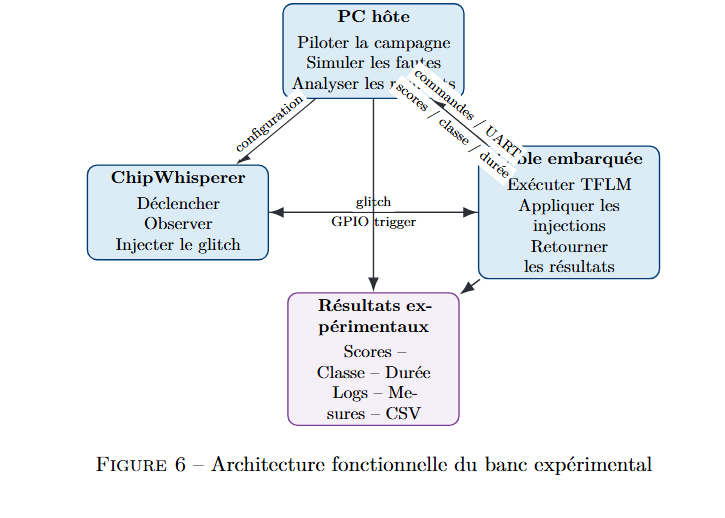
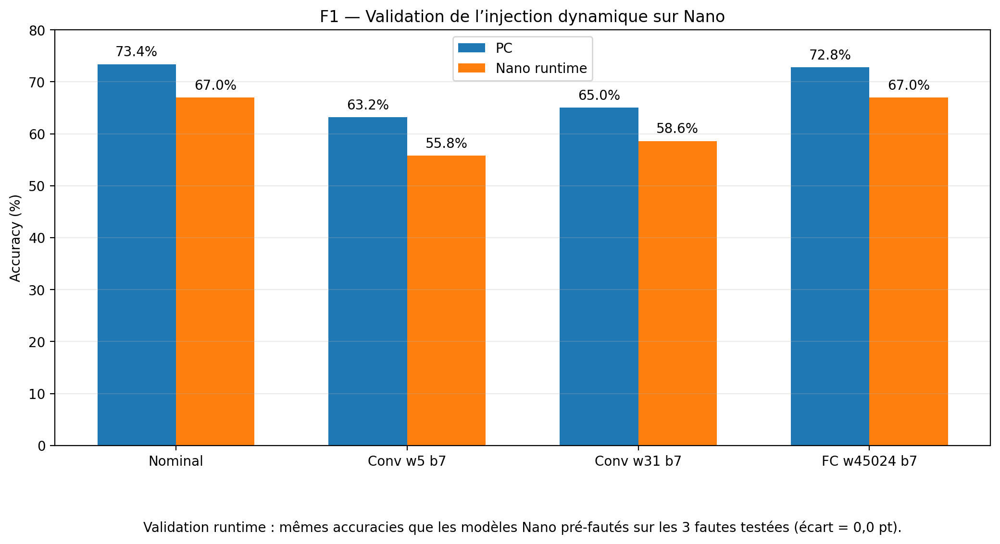
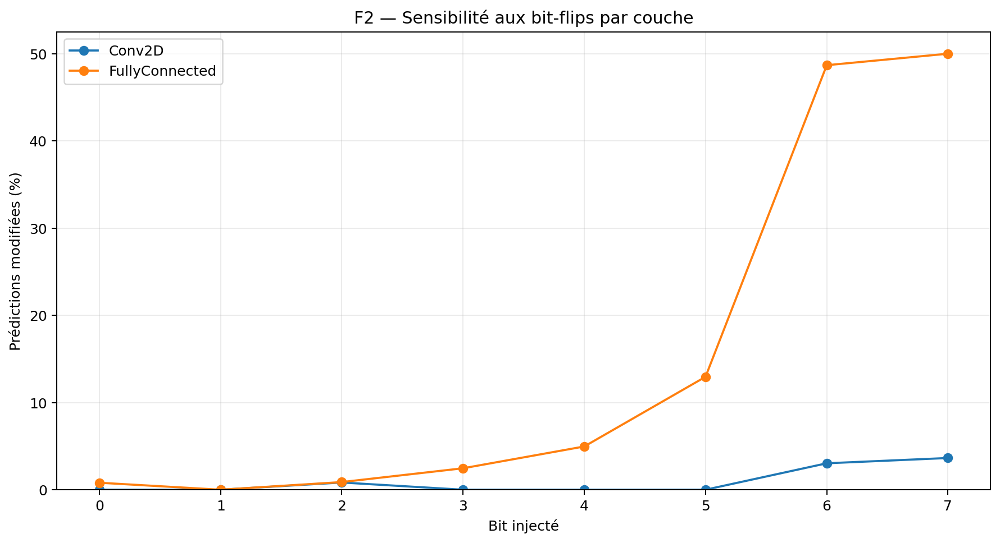
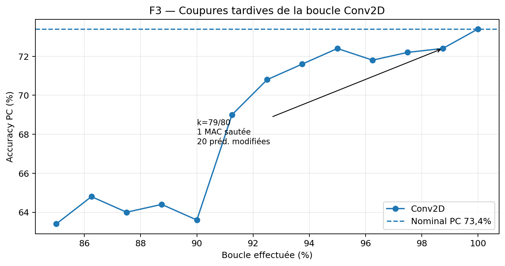
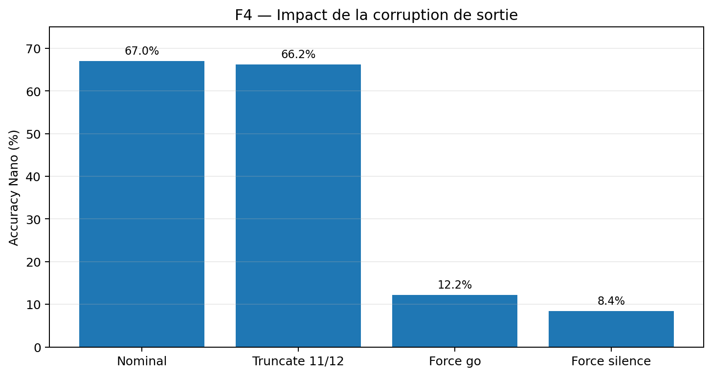

# FIATSAR — TinyML Robustness on Arduino Nano 33 BLE

Academic engineering project focused on the robustness of **TinyML Keyword Spotting (KWS)** models against:

- **adversarial perturbations** on the input;
- **software-simulated faults** inside an INT8 neural network;
- reproduction of selected faults on an **Arduino Nano 33 BLE** with TensorFlow Lite Micro.

> **Work in progress.** This repository is a curated public snapshot of the project, not the complete internal workspace.

## Project overview

The benchmark uses a 12-class Keyword Spotting task derived from Google Speech Commands:

`_silence_`, `_unknown_`, `yes`, `no`, `up`, `down`, `left`, `right`, `on`, `off`, `stop`, `go`.

The experimental chain is designed to keep the same quantized inputs between desktop TFLite and the embedded target.




## My contribution

This is a **two-student academic project**. My main contribution is the embedded / fault-injection side:

- TinyConv deployment on Arduino Nano 33 BLE;
- binary USB CDC / serial campaign protocol;
- deterministic PC ↔ Nano campaigns;
- **F1** runtime bit-flip injection in model weights;
- **F2** transient activation corruption experiments;
- **F3** truncated-accumulation / instruction-skip approximation;
- **F4** output corruption experiments;
- latency measurement, CSV logging and PC ↔ Nano comparison;
- investigation of numerical consistency between desktop TFLite and TFLite Micro.

The ML / adversarial branch (noise, FGSM, PGD, adversarial training, DS-CNN) is developed jointly within the project.

## Fault models

| ID | Fault model | Injection target | Current status |
|---|---|---|---|
| **F1** | INT8 weight bit-flip | Conv2D / FullyConnected weights | Runtime injection validated on Nano |
| **F2** | Bit-flip / zeroing of an activation | Conv output / FC logits | Simulated + critical cases replayed on Nano |
| **F3** | Truncated accumulation | Conv / FC computation | Functional reproduction on Nano |
| **F4** | Output corruption | output scores / argmax | Dynamic reproduction on Nano |

## Selected results

### F1 — runtime weight bit-flip

A single firmware copies the TFLite model to RAM, applies a targeted bit-flip, rebuilds the TFLM interpreter and restores the original byte on command.

| Case | Nano accuracy | Δ vs nominal | Predictions changed |
|---|---:|---:|---:|
| Nominal | 67.0% | 0.0 pt | 0 / 500 |
| Conv w5 bit7 | **55.8%** | **-11.2 pt** | 156 / 500 |
| Conv w31 bit7 | **58.6%** | **-8.4 pt** | 143 / 500 |
| FC w45024 bit7 | 67.0% | 0.0 pt | 0 / 500 |

The runtime campaign reproduces the same Nano accuracies as the earlier pre-faulted models, while avoiding one firmware/model build per fault.



### F2 — activation faults

The campaign performs 4,000 Monte-Carlo injections across Conv2D and FullyConnected activations.

- FC logits are much more sensitive than the flattened Conv output.
- For bit 7, about **50%** of sampled FC-logit injections change the prediction vs about **3.6%** for Conv.
- The selected Nano Top-10 changes the prediction in **10/10** cases.
- Critical transitions include `go → silence`, `left → right`, `on → off`, and `stop → go`.



### F3 — truncated accumulation

F3 approximates an instruction-skip / early-exit by stopping an accumulation loop before all terms are processed.

A late Conv candidate at **k=79/80** (only one contribution skipped) still changes predictions. This is currently a **functional fault model**, not a physical instruction skip.



### F4 — output corruption

The output layer is highly sensitive to late corruption:

- truncating the decision to `k=11/12`: Nano accuracy ≈ **66.2%**;
- forcing `go`: Nano accuracy ≈ **12.2%**;
- forcing `_silence_`: Nano accuracy ≈ **8.4%**.

For the `_silence_` case, the faulted prediction matches between PC and Nano for **500/500 samples** in the recorded campaign.



## Repository layout

```text
FIATSAR-TinyML-Robustness/
├── docs/
│   ├── ARCHITECTURE.md
│   ├── RESULTS.md
│   ├── REPRODUCTION.md
│   └── figures/
├── firmware/
│   ├── f1_runtime/
│   ├── f4_dynamic/
│   └── experimental/
├── models/
├── results/
│   ├── f1/
│   ├── f2/
│   ├── f3/
│   ├── f4/
│   └── adversarial/
├── scripts/
│   ├── data/
│   ├── faults/
│   ├── tools/
│   └── analysis/
└── requirements.txt
```

## Quick start

### 1. Python environment

```bash
python -m venv .venv
# Windows
.venv\Scripts\activate
pip install -r requirements.txt
```

### 2. Generate the Arduino model header

```bash
python scripts/tools/10_tflite_to_model_data.py \
  --model models/tiny_conv_int8.tflite \
  --output firmware/f1_runtime/model_data.h
```

### 3. F1 runtime

Generate / verify the TFLite weight offsets:

```bash
python scripts/faults/f1/f1_offsets.py \
  --model models/tiny_conv_int8.tflite \
  --output firmware/f1_runtime/f1_offsets.h
```

Compile `firmware/f1_runtime/tiny_conv_uart_f1_runtime.ino` in Arduino IDE, then:

```bash
python scripts/faults/f1/26_test_f1_runtime.py --port COM3 \
  --baseline YOUR_BASELINE.npz --sample 0 \
  --tensor 6 --index 5 --bit 7
```

The full 500-sample campaign is run with:

```bash
python scripts/faults/f1/27_uart_f1_runtime_500.py \
  --port COM3 --baseline YOUR_BASELINE.npz \
  --output-dir resultats_runtime
```

See `docs/REPRODUCTION.md` for the other fault campaigns.

## Hardware / software

- Arduino Nano 33 BLE / nRF52840 Cortex-M4F
- TensorFlow / Keras
- TensorFlow Lite INT8
- TensorFlow Lite Micro
- Python
- NumPy / Pandas
- PySerial
- Arduino IDE

## Notes / current limitations

- F3 currently reproduces the **functional effect** of a truncated accumulation; it is not yet a physical processor-level instruction skip.
- F4 corruption is applied at / after the output stage in the current software fault model.
- Some legacy PC ↔ Nano fault campaigns were not score-level bit-exact; the repository therefore reports both prediction-level effects and fault-induced transitions.
- ChipWhisperer clock / voltage glitching is outside this public snapshot and remains a later project stage.
- The full Google Speech Commands dataset is **not bundled** in this repository.

## Academic project

FIATSAR is an ENSIM 5A engineering project. This repository is published as a portfolio snapshot to document the architecture, reproducible experiments and embedded fault-injection work.

No open-source license is granted yet; see `NOTICE.md`.
"# FIATSAR-TinyML-Robustness" 
