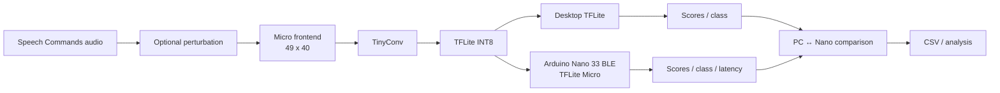
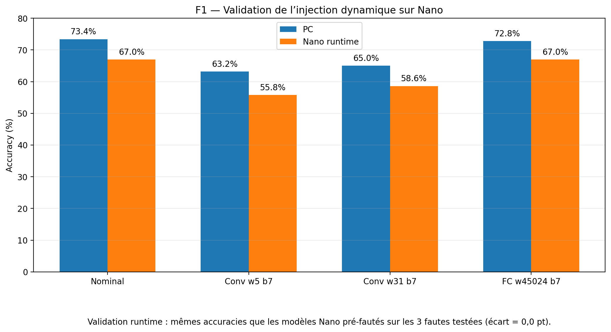
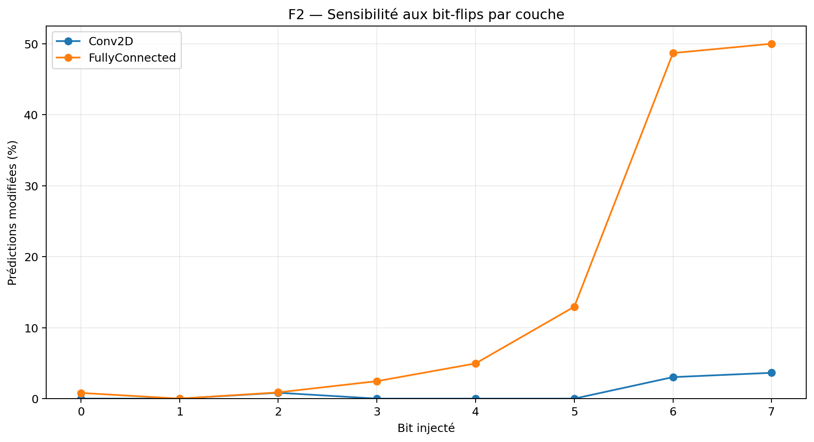
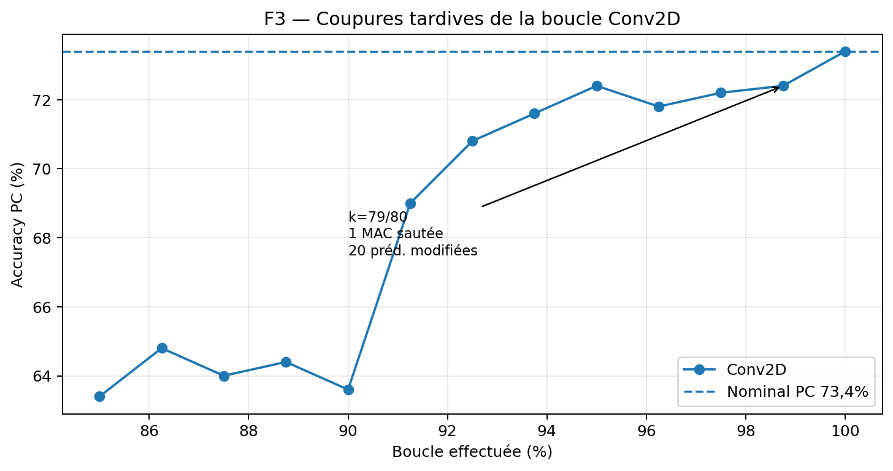
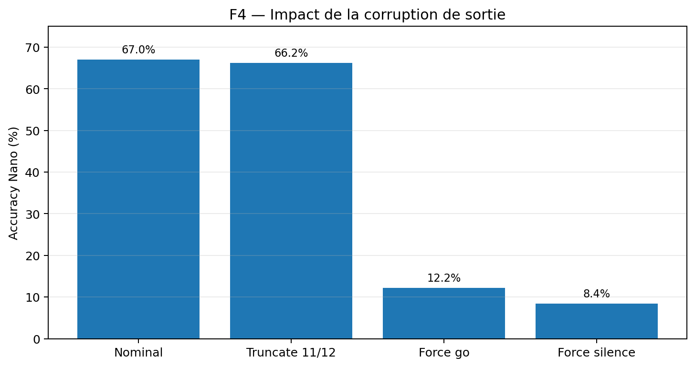

# FIATSAR — TinyML Robustness on Arduino Nano 33 BLE Sense

Academic engineering project focused on the robustness of **TinyML Keyword Spotting (KWS)** models under realistic noise, adversarial perturbations and software-simulated faults.

The project studies the complete chain from **Google Speech Commands** to a quantized model running on an **Arduino Nano 33 BLE Sense** with TensorFlow Lite Micro.

> **Work in progress.**  
> This repository is a curated public snapshot of the project and does not contain the complete internal workspace or dataset.

---

## Project objective

The main research question is:

> **Can an embedded keyword-spotting model remain reliable when its input or internal computation is perturbed?**

The target use case is an embedded voice-command system, for example in an assisted or autonomous vehicle.

Some classification errors are therefore more critical than others:

- `stop → go`
- `left → right`
- `on → off`
- command → `_silence_`

A missed command can be as important as a wrong command.


---

## From a 2-class prototype to a 12-class benchmark

The project started with a small **2-class prototype** used to validate the inference pipeline.

The final benchmark is based on **Google Speech Commands v0.02**.

### Dataset

- **105,829** audio clips
- **35 words**
- **2,618 speakers**
- **1 second** per clip
- **16 kHz** sampling rate

The final TinyConv task contains **12 classes**:

```text
_silence_
_unknown_
yes
no
up
down
left
right
on
off
stop
go
```

The reproducible subset used by the current pipeline contains:

| Split | Samples |
|---|---:|
| Train | 35,693 |
| Validation | 4,297 |
| Test | 4,726 |
| **Total** | **44,716** |

The audio frontend produces a **49 × 40 spectrogram-like feature map**, i.e. **1,960 input features per clip**.


---

## Experimental pipeline

The experimental chain is designed so that desktop TFLite and the embedded target can receive the **same quantized input**.




### Main technologies

- Python
- TensorFlow / Keras
- TensorFlow Lite
- TensorFlow Lite Micro
- Arduino Nano 33 BLE Sense
- USB CDC / serial protocol
- NumPy
- Pandas
- Matplotlib
- PySerial

---

## Work distribution

This is a **two-student academic project**.

### Benewinde — ML / robustness

Main responsibilities:

- dataset preparation and generation;
- training and retraining;
- additive-noise experiments;
- FGSM / PGD campaigns;
- robustness analysis;
- confusion matrices and scientific figures;
- comparison of defensive training strategies.

### Michael — embedded / validation

My main contribution is the embedded and fault-injection side:

- TensorFlow Lite Micro deployment;
- Arduino Nano 33 BLE Sense integration;
- binary USB CDC / serial protocol;
- quantization and model compatibility;
- deterministic PC ↔ Nano campaigns;
- latency and memory measurements;
- robust-model validation on the target;
- F1 runtime weight bit-flips;
- F2 activation corruption;
- F3 truncated-accumulation experiments;
- F4 output corruption;
- investigation of numerical consistency between desktop TFLite and TFLite Micro.

### Joint work

- literature review;
- methodology;
- project requirements;
- result interpretation;
- reports;
- presentations;
- final demonstrator.

---

# Noise robustness study

Two complementary noise families are evaluated.

## Gaussian white noise

Gaussian noise is useful because it is:

- synthetic;
- controlled;
- reproducible;
- approximately stationary;
- suitable for isolating the effect of SNR.

## Real background noise

Background recordings are taken from the Speech Commands `_background_noise_` directory.

Examples include:

- `doing_the_dishes.wav`
- `running_tap.wav`
- `exercise_bike.wav`

These recordings provide more realistic, non-flat spectral content and are useful for testing generalization to unseen noise.


---

## SNR range

The experiments study several Signal-to-Noise Ratio levels:

```text
30 dB → 20 dB → 15 dB → 10 dB → 5 dB → 0 dB
```

The literature review motivated a plausible real-world range around **+5 to +15 dB**.

We selected:

> **10 dB as the nominal noisy operating point**

because it creates a measurable degradation without being an artificially catastrophic condition.


---

## Experimental methodology

Two complementary scenarios are used.

### Scenario B — noise only at test time

The model is kept unchanged.

```text
Clean model
    ↓
Noisy test set
    ↓
Evaluation
```

Objective:

> Measure the fragility of an already deployed model.

### Scenario A — robust retraining

Noise is injected during training.

```text
Noisy / mixed training set
    ↓
Keras retraining
    ↓
Noisy + clean evaluation
```

Objective:

> Improve robustness while preserving clean-data accuracy.

Main metrics:

- accuracy;
- attack / flip rate;
- recall per class;
- confusion matrices;
- SNR;
- PC ↔ Nano agreement.

---

# Noise robustness results

## Reference INT8 TinyConv

The original TensorFlow-trained reference model already includes online augmentation during training.

| Test condition | Accuracy |
|---|---:|
| Clean | 73.9% |
| 30 dB | 74.9% |
| 20 dB | 73.6% |
| 15 dB | 71.8% |
| 10 dB | 68.0% |
| 5 dB | 62.1% |
| 0 dB | 53.4% |

The model remains relatively stable until approximately **20 dB**, then degrades increasingly below 15–10 dB.


---

## Class-level degradation

Noise does not affect every keyword uniformly.

At **10 dB**:

- `stop`: 85% → 57%
- `left`: 76% → 64%
- `no`: 66% → 56%

At **0 dB**:

- `stop`: 85% → 29%
- `right`: 84% → 50%
- `left`: 76% → 50%
- `no`: 66% → 39%

Typical new confusions include:

- `left → yes`
- `stop → up`
- `stop → off`
- `no → go`


### Example confusion matrices

Low-noise condition:


Severe-noise condition:


---

# Robust training

## Fixed-SNR training

Training on one fixed noise level improves performance close to that SNR, but strongly degrades clean-speech performance.

Example:

| Model | Clean | Test at 10 dB |
|---|---:|---:|
| Keras clean | 75.0% | 55.0% |
| Keras trained at 10 dB | **36.2%** | **72.0%** |

The 10 dB specialist therefore performs well at its training SNR but becomes almost unusable in quiet conditions.

---

## Mixed 0–20 dB training

The best current compromise is a mixed training strategy:

```text
clean training set
+
one Gaussian-noise copy
with random SNR ∈ [0, 20] dB
```

### Results

| Test condition | Mixed model accuracy |
|---|---:|
| Clean | **75.9%** |
| 10 dB | **71.6%** |
| 5 dB | **66.6%** |
| 0 dB | **59.5%** |

The mixed model:

- preserves clean accuracy;
- significantly improves robustness;
- avoids over-specializing to a single SNR.


### Generalization to real background noise

The model was trained with Gaussian noise only, but still generalizes to real background noise:

| Background-noise condition | Accuracy |
|---|---:|
| 10 dB | **69.3%** |
| 0 dB | **54.0%** |

This indicates that the robustness learned from Gaussian augmentation partially transfers to unseen acoustic perturbations.

---

# Arduino integration

## From TFLite to firmware

The robust model is trained and quantized on the PC, then integrated into the Arduino firmware.

```text
keras_train_mixte_snr0-20dB_int8.tflite
                    ↓
        TFLM compatibility adaptation
                    ↓
keras_train_mixte_snr0-20dB_arduino.tflite
                    ↓
          C/C++ byte-array conversion
                    ↓
      micro_features_model.cpp / .h
                    ↓
              Arduino sketch
                    ↓
        Arduino Nano 33 BLE Sense
```

The model is compiled directly into the firmware.

Example:

```cpp
alignas(16) const unsigned char g_model[] = {
    0x20, 0x00, 0x00, ...
};

const int g_model_len = 51224;
```

The sketch accesses it through:

```cpp
#include "micro_features_model.h"
```


---

## Embedded configuration

| Item | Value |
|---|---:|
| MCU | nRF52840 Cortex-M4F |
| Model format | TFLite Micro INT8 |
| Model size | **51,224 bytes** |
| Input | **1 × 1,960 INT8** |
| Tensor arena used | **9,060 bytes** |
| Tensor arena reserved | **16,384 bytes** |
| Firmware size | **210,680 bytes** |
| Flash usage | **21%** |
| Global RAM usage | **114,080 bytes** |
| RAM usage | **43%** |

---

# PC ↔ Nano validation protocol

For deterministic campaigns, the PC prepares the same quantized input used by desktop TFLite.

The serial protocol sends:

```text
PC → Nano

0xA5
+
1960 INT8 input bytes
```

The Nano executes TFLite Micro and returns:

```text
Nano → PC

response header
+
12 output scores
+
predicted class
+
inference latency
```

The desktop prediction and embedded prediction are then compared automatically.


---

## Nominal embedded validation

A fixed set of **500 samples** is executed on both desktop TFLite and the Nano.

| Metric | Result |
|---|---:|
| PC INT8 accuracy | **75.20%** |
| Nano INT8 accuracy | **75.20%** |
| PC ↔ Nano prediction agreement | **100%** |
| Mean inference latency | **83.191 ms** |

This validates that the current embedded deployment does not introduce measurable prediction degradation on the nominal test subset.

---

# Embedded noisy campaigns

The mixed 0–20 dB model was then evaluated on noisy inputs.

| Condition | PC INT8 | Nano INT8 | Agreement | Status |
|---|---:|---:|---:|---|
| Clean* | 75.20% | 75.20% | 100% | ✅ Validated |
| 30 dB | 75.16% | 75.20% | 99.96% | ✅ Validated |
| 20 dB | 74.31% | 74.27% | 99.96% | ✅ Validated |
| 10 dB | 71.54% | — | ≈99.9% until ~3,000 | ⚠ Replay required |
| 5 dB | 67.05% | — | — | ⚠ Replay required |
| 0 dB | 59.44% | — | — | ⚠ Replay required |

\* Clean uses the fixed 500-sample subset.  
30 and 20 dB use all **4,726 test samples**.


---

## UART campaign incident

During the long 10 dB campaign, PC/Nano agreement remained approximately:

> **99.9% for the first ~3,000 samples**

The host then received:

```text
received header : 0xC3
expected header : 0x5A
```

indicating a serial framing desynchronization.

After this event:

- the response stream remained shifted;
- subsequent 5 and 0 dB runs started with very low PC/Nano agreement;
- inference latency remained close to **84 ms**.

The stable latency indicates that the Nano was still executing inference correctly while the host was no longer decoding the expected frame boundaries.

Therefore:

> **Nano values collected after the UART desynchronization are not interpreted as model performance.**

Planned protocol improvements:

- reset the Nano between test conditions;
- reopen the serial port between campaigns;
- explicit resynchronization on the response header;
- sequence IDs;
- packet length;
- optional CRC.


---

# Fault-injection experiments

The fault-injection branch studies software-reproducible faults inside the INT8 model and its execution.

## Fault models

| ID | Fault model | Injection target | Current status |
|---|---|---|---|
| **F1** | INT8 weight bit-flip | Conv2D / FullyConnected weights | Runtime injection validated on Nano |
| **F2** | Bit-flip / zeroing of an activation | Conv output / FC logits | Simulated + critical cases replayed on Nano |
| **F3** | Truncated accumulation | Conv / FC computation | Functional reproduction on Nano |
| **F4** | Output corruption | output scores / argmax | Dynamic reproduction on Nano |

> Fault-injection campaigns use their own fixed experimental baseline.  
> These historical F1/F2/F3/F4 baselines should not be directly compared with the newer mixed-noise model results above.

---

## F1 — runtime weight bit-flip

A single firmware copies the TFLite model to RAM, applies a targeted bit-flip, rebuilds the TFLM interpreter and restores the original byte on command.

| Case | Nano accuracy | Δ vs campaign baseline | Predictions changed |
|---|---:|---:|---:|
| Nominal | 67.0% | 0.0 pt | 0 / 500 |
| Conv w5 bit7 | **55.8%** | **-11.2 pt** | 156 / 500 |
| Conv w31 bit7 | **58.6%** | **-8.4 pt** | 143 / 500 |
| FC w45024 bit7 | 67.0% | 0.0 pt | 0 / 500 |

The `FC w45024 bit7` case changes the selected byte but does not alter the predicted class on this 500-sample campaign.

This illustrates an important property of fault injection:

> Not every bit-flip has an observable effect on the final prediction.



---

## F2 — activation faults

The campaign performs **4,000 Monte-Carlo injections** across Conv2D and FullyConnected activations.

Main observations:

- FC logits are significantly more sensitive than flattened Conv output;
- for bit 7, approximately **50%** of sampled FC-logit injections change the prediction;
- the equivalent value for Conv is approximately **3.6%**;
- the selected Nano Top-10 changes the prediction in **10/10** cases.

Observed critical transitions include:

```text
go → silence
left → right
on → off
stop → go
```



---

## F3 — truncated accumulation

F3 approximates an instruction-skip / early-exit by stopping an accumulation loop before all contributions have been processed.

A late Conv candidate at:

```text
k = 79 / 80
```

meaning that only one contribution is skipped, can still change predictions.

This is currently a:

> **functional fault model**

and not yet a physical CPU-level instruction skip.



---

## F4 — output corruption

The output stage is highly sensitive to late corruption.

Examples:

- truncated decision at `k = 11 / 12`: accuracy ≈ **66.2%**
- forced `go`: accuracy ≈ **12.2%**
- forced `_silence_`: accuracy ≈ **8.4%**

For the `_silence_` experiment, the faulted PC and Nano predictions match for:

> **500 / 500 samples**

in the recorded campaign.



---

# Adversarial robustness

The adversarial branch evaluates gradient-based perturbations such as:

- FGSM
- PGD

Current work focuses on:

- measuring robustness as a function of perturbation budget;
- adversarial training;
- testing robustness transfer between clean, noisy and adversarial conditions;
- studying whether feature-space perturbations can be related back to physically meaningful audio perturbations.

This part is still under active development and will be expanded as the results stabilize.

---

# Repository layout

```text
FIATSAR-TinyML-Robustness/
├── docs/
│   ├── ARCHITECTURE.md
│   ├── RESULTS.md
│   ├── REPRODUCTION.md
│   └── figures/
│       ├── project_context.png
│       ├── dataset_evolution.png
│       ├── experimental_pipeline.png
│       ├── noise_families.png
│       ├── snr_range.png
│       ├── reference_accuracy_snr.png
│       ├── class_recall_noise.png
│       ├── confusion_reference_30db.png
│       ├── confusion_reference_0db.png
│       ├── model_comparison_snr.png
│       ├── tflite_to_arduino.png
│       ├── pc_nano_protocol.png
│       ├── embedded_noise_results.png
│       ├── uart_incident.png
│       ├── f1_runtime.png
│       ├── f2_sensitivity.png
│       ├── f3_truncation.png
│       └── f4_output.png
├── firmware/
│   ├── f1_runtime/
│   ├── robust_model/
│   ├── f4_dynamic/
│   └── experimental/
├── models/
│   ├── tiny_conv_int8.tflite
│   └── mixed_noise/
├── results/
│   ├── noise/
│   ├── embedded/
│   ├── f1/
│   ├── f2/
│   ├── f3/
│   ├── f4/
│   └── adversarial/
├── scripts/
│   ├── data/
│   ├── noise/
│   ├── faults/
│   ├── uart/
│   ├── tools/
│   └── analysis/
├── requirements.txt
└── NOTICE.md
```

---

# Quick start

## 1. Python environment

```bash
python -m venv .venv

# Windows
.venv\Scripts\activate

pip install -r requirements.txt
```

---

## 2. Prepare the baseline

The repository does not bundle the full Google Speech Commands dataset.

Generate or export the fixed test baseline before running embedded campaigns.

See:

```text
docs/REPRODUCTION.md
```

for the exact preprocessing pipeline and expected `.npz` structure.

Typical baseline content:

```text
X : quantized or preprocessed model inputs
y : ground-truth labels
```

---

## 3. Generate the Arduino model header

```bash
python scripts/tools/10_tflite_to_model_data.py \
  --model models/tiny_conv_int8.tflite \
  --output firmware/f1_runtime/model_data.h
```

---

## 4. F1 runtime

Generate / verify TFLite weight offsets:

```bash
python scripts/faults/f1/f1_offsets.py \
  --model models/tiny_conv_int8.tflite \
  --output firmware/f1_runtime/f1_offsets.h
```

Compile:

```text
firmware/f1_runtime/tiny_conv_uart_f1_runtime.ino
```

with Arduino IDE.

Then run:

```bash
python scripts/faults/f1/26_test_f1_runtime.py \
  --port COM3 \
  --baseline YOUR_BASELINE.npz \
  --sample 0 \
  --tensor 6 \
  --index 5 \
  --bit 7
```

Full campaign:

```bash
python scripts/faults/f1/27_uart_f1_runtime_500.py \
  --port COM3 \
  --baseline YOUR_BASELINE.npz \
  --output-dir results/runtime
```

See `docs/REPRODUCTION.md` for the other campaigns.

---

# Hardware

Primary embedded target:

- **Arduino Nano 33 BLE Sense**
- Nordic **nRF52840**
- ARM Cortex-M4F
- USB CDC serial communication

Additional hardware may be used in later project stages for physical fault-injection experiments.

---

# Software

Core stack:

- Python 3
- TensorFlow / Keras
- TensorFlow Lite
- TensorFlow Lite Micro
- NumPy
- Pandas
- Matplotlib
- PySerial
- Arduino IDE

Exact versions used for the reproducible experiments should be listed in:

```text
requirements.txt
docs/REPRODUCTION.md
```

---

# Current limitations

- The full Google Speech Commands dataset is not bundled.
- F3 currently reproduces the **functional effect** of truncated accumulation and is not a physical instruction skip.
- F4 corruption is currently applied at or after the output stage.
- Some historical fault-injection campaigns use a different fixed baseline from the recent noise-robustness campaigns.
- The recent Nano campaigns at **10, 5 and 0 dB** must be replayed after the UART framing incident.
- The current serial protocol is being improved with stronger synchronization and error detection.
- Adversarial robustness work is still ongoing.
- Physical clock / voltage glitching is outside the current public snapshot.

---

# Current project status

| Work package | Status |
|---|---|
| Functional analysis / literature review | ✅ Validated |
| 12-class TinyConv benchmark | ✅ Validated |
| Gaussian-noise evaluation | ✅ Validated |
| Mixed 0–20 dB defense | ✅ Validated |
| INT8 quantization | ✅ Validated |
| Nominal Nano deployment | ✅ Validated |
| Nano 30 / 20 dB campaigns | ✅ Validated |
| Nano 10 / 5 / 0 dB campaigns | ⚠ Replay required |
| Adversarial FGSM / PGD | 🚧 In progress |
| DS-CNN comparison | 🚧 In progress |
| Final demonstrator | ⏳ Planned |

---

# Key results

At the current stage:

### Noise robustness

```text
Mixed model:
Clean : 75.9%
10 dB : 71.6%
0 dB  : 59.5%
```

### Embedded validation

```text
Nominal:
PC INT8   : 75.20%
Nano INT8 : 75.20%
Agreement : 100%

30 dB:
Agreement : 99.96%

20 dB:
Agreement : 99.96%

Latency:
≈ 83.19 ms / inference
```

### Fault injection

```text
F1:
Conv w5 bit7 → -11.2 accuracy points

F2:
FC-logit bit-7 injections ≈ 50% prediction-change rate

F3:
prediction changes possible even at k=79/80

F4:
forcing output classes can collapse accuracy to ≈8–12%
```

---

# Academic project

FIATSAR is an **ENSIM 5A engineering project**.

This repository is published as a portfolio snapshot documenting:

- TinyML deployment;
- reproducible robustness experiments;
- noise robustness;
- embedded validation;
- software fault injection;
- adversarial robustness research.

No open-source license is currently granted.

See:

```text
NOTICE.md
```

for reuse conditions.
