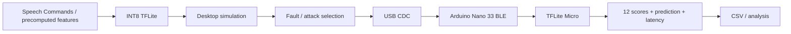

# Architecture

## Common experimental chain



The PC controls the campaigns, selects the fault parameters and logs the experiment.
The Nano executes TFLite Micro and returns the outputs through a compact binary serial protocol.

## Fault injection locations

```text
Input → Conv2D → Activations → FullyConnected → Softmax → Decision
          ↑            ↑               ↑             ↑          ↑
         F1            F2              F1/F2         F4         F4
          └──────────── F3: truncated accumulation ─────────────┘
```

### F1
Persistent bit-flip in an INT8 model weight.

### F2
Transient corruption of an intermediate activation.

### F3
Functional approximation of an instruction skip / truncated accumulation.

### F4
Transient output corruption: truncated decision or forced score.
